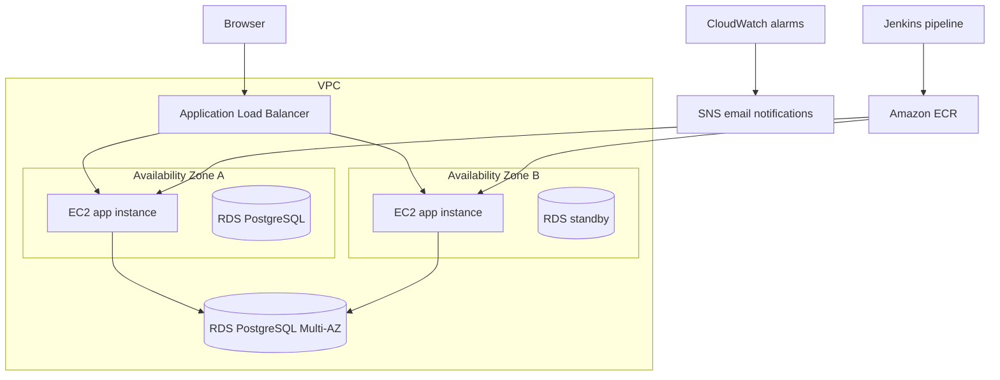

# Catalog Web App on AWS

A small product catalog app used to practice deploying an application on AWS with Terraform and Jenkins. The app runs on EC2 instances in private subnets. An Application Load Balancer sends traffic to healthy instances, and an Auto Scaling Group replaces unhealthy instances and can scale based on CPU.

## Architecture



The app instances and database are in private subnets across two Availability Zones. The ALB is public. A NAT Gateway provides outbound access for resources in private subnets.

## What it includes

- A VPC with public, application, and database subnets across two Availability Zones
- An internet-facing Application Load Balancer with an HTTP listener and `/health` check
- An EC2 Auto Scaling Group running the app in Docker
- Rolling instance refresh when the launch template changes
- Amazon RDS for PostgreSQL with Multi-AZ enabled
- Amazon ECR for application images
- IAM role and instance profile for the EC2 instances
- CloudWatch alarms for high CPU and ALB 5xx responses, with SNS email alerts
- Terraform modules and remote state in S3, with state locking
- A Jenkins pipeline for formatting, validation, Checkov scanning, image build and push, Terraform plan, approval, and apply

## Repository layout

```text
application/          Flask app, templates, Dockerfile, and SQL initialization
jenkins-server/       Local Jenkins Docker setup
terraform/
  bootstrap-state/    S3 bucket and DynamoDB lock table for Terraform state
  environments/dev/   Development environment configuration
  modules/            Reusable Terraform modules
Jenkinsfile           Jenkins pipeline
```

## Requirements

- An AWS account with access to create the resources listed above
- AWS CLI configured with an IAM Identity Center profile
- Terraform
- Docker Desktop with WSL integration enabled
- GitHub and a local Jenkins instance

The examples below use the profile `catalog-admin`, region `ap-south-2`, and the Jenkins URL `http://localhost:8081`. Change them if your setup differs.

## Set up AWS access

Log in to the AWS CLI profile and verify which account it uses:

```bash
aws sso login --profile catalog-admin
aws sts get-caller-identity --profile catalog-admin
```

Jenkins reads the AWS CLI configuration mounted from `~/.aws`. If the SSO session expires, log in again from WSL before starting a build.

The Jenkins job also expects a Jenkins **Secret text** credential with the ID `sns-alert-email`. Its value is the email address that should receive the SNS alerts.

## Set up Terraform state

Create the state bucket and lock table once:

```bash
cd terraform/bootstrap-state
AWS_PROFILE=catalog-admin terraform init
AWS_PROFILE=catalog-admin terraform apply
```

Then initialize the development environment:

```bash
cd ../environments/dev
AWS_PROFILE=catalog-admin terraform init
```

The environment backend must point to the state bucket and lock table created by the bootstrap configuration. Keep the bootstrap state resources; the dev environment uses them to store its Terraform state.

## First Jenkins deployment

The Jenkins image stage reads the ECR repository URL from Terraform state, so the repository must exist before the first pipeline run. If it has not been created yet, create it from the dev environment first:

1. Set `alert_email` in a local `terraform.tfvars` file in `terraform/environments/dev`. Do not commit that file.
2. Run:

```bash
cd terraform/environments/dev
AWS_PROFILE=catalog-admin terraform init
AWS_PROFILE=catalog-admin terraform apply -target=module.container_registry
```

After that, create or run the Jenkins job configured to use this repository’s `Jenkinsfile`.

The pipeline builds an image tagged with the Git commit and Jenkins build number, pushes it to ECR, then creates a Terraform plan. Review the plan in Jenkins. The approval step is what allows Terraform to apply the plan and roll out the new launch template to the Auto Scaling Group.

## Check the deployment

Get the ALB address from Terraform:

```bash
cd terraform/environments/dev
AWS_PROFILE=catalog-admin terraform output -raw load_balancer_dns_name
```

Open the address using `http://`, or check the health endpoint:

```bash
curl http://<ALB-DNS-NAME>/health
```

The health endpoint should return:

```json
{"status":"ok"}
```

The product catalog is served from the ALB root URL.

## Costs and cleanup

This stack creates billable resources. The main cost drivers are the NAT Gateway, ALB, Multi-AZ RDS instance, and EC2 instances. Run it only while you are working with it, and check the AWS billing page for actual charges.

When finished, destroy the dev environment from its directory:

```bash
cd terraform/environments/dev
AWS_PROFILE=catalog-admin terraform destroy
```

Review the destroy plan before confirming. The separate Terraform state bucket and lock table remain in `bootstrap-state`; keep them if you plan to use the project again.

## Notes

- The Jenkins Compose setup mounts the local Docker socket so Jenkins can build images using Docker Desktop. This gives Jenkins control over the local Docker engine; use this setup only on a machine you control.
- The ALB currently serves HTTP. HTTPS would require a domain name and an ACM certificate.
- Do not commit AWS credentials, `terraform.tfstate`, `.tfvars` files, or Terraform plan files.